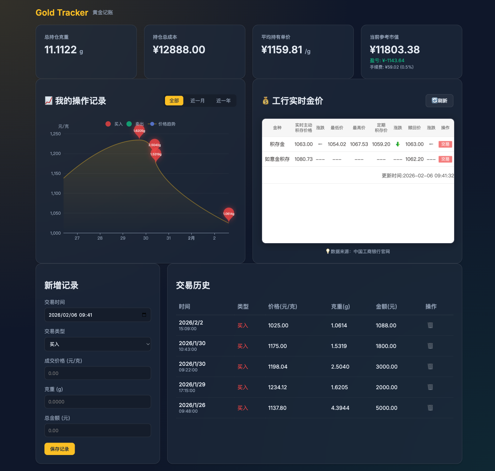

# Gold Tracker - 黄金持仓记账系统

<p align="center">
  
  
  
  
  
</p>

一个简洁优雅的黄金投资记账工具，帮助你追踪黄金买卖记录、计算持仓成本和盈亏情况。支持工行实时金价查询。

## 效果截图



## 功能特性

- **持仓统计仪表盘**：实时显示总持仓克重、持仓成本、平均单价、当前市值及盈亏
- **交易记录管理**：支持买入/卖出记录的添加、查看和删除
- **可视化图表**：使用 ECharts 展示交易操作历史，买入/卖出点位一目了然
- **工行实时金价**：内嵌工行黄金积存页面，实时查看买入价和赎回价
- **自动计算**：
  - 自动计算交易金额（价格 × 克重）
  - 自动计算平均持仓成本
  - 基于赎回价计算实际可得（扣除 0.5% 手续费）
- **深色主题 UI**：现代化的 Glassmorphism 玻璃拟态设计

## 技术栈

| 层级 | 技术 |
|------|------|
| 前端 | HTML5, CSS3 (Glassmorphism), JavaScript ES6+ |
| 图表 | ECharts 5.x |
| 后端 | Node.js + Express 4.x |
| 数据库 | MySQL 8.0+ |
| API | 工行黄金 API 代理 |

## 项目结构

```
gold-panning/
├── index.html              # 前端入口页面
├── src/
│   ├── app.js              # 前端主逻辑
│   ├── api.js              # 金价 API 客户端
│   ├── db-client.js        # 数据库 API 客户端
│   └── style.css           # 样式文件
├── server/
│   ├── server.js           # Express 服务器
│   ├── db.js               # MySQL 连接池
│   ├── setup-db.js         # 数据库初始化脚本
│   ├── .env.example        # 环境变量示例
│   └── package.json        # 后端依赖
├── database/
│   └── schema.sql          # 数据库表结构
├── screenshots/            # 效果截图
└── README.md
```

## 部署教程

### 环境要求

- Node.js >= 18.0
- MySQL >= 8.0
- npm 或 yarn

### 1. 克隆项目

```bash
git clone https://github.com/yourusername/gold-panning.git
cd gold-panning
```

### 2. 配置数据库

#### 2.1 创建数据库

```sql
CREATE DATABASE gold_tracker CHARACTER SET utf8mb4 COLLATE utf8mb4_unicode_ci;
```

#### 2.2 创建数据表

在 MySQL 中执行 `database/schema.sql` 文件：

```bash
mysql -u your_user -p gold_tracker < database/schema.sql
```

或者手动执行：

```sql
-- 交易记录表
CREATE TABLE `gold_transactions` (
  `id` VARCHAR(36) PRIMARY KEY COMMENT '交易ID (UUID)',
  `date` DATETIME NOT NULL COMMENT '交易时间',
  `type` ENUM('buy', 'sell') NOT NULL COMMENT '交易类型：buy=买入, sell=卖出',
  `price` DECIMAL(10, 2) NOT NULL COMMENT '单价（元/克）',
  `weight` DECIMAL(10, 4) NOT NULL COMMENT '重量（克）',
  `amount` DECIMAL(12, 2) NOT NULL COMMENT '总金额（元）',
  `created_at` TIMESTAMP DEFAULT CURRENT_TIMESTAMP,
  `updated_at` TIMESTAMP DEFAULT CURRENT_TIMESTAMP ON UPDATE CURRENT_TIMESTAMP,
  INDEX `idx_date` (`date`),
  INDEX `idx_type` (`type`)
) ENGINE=InnoDB DEFAULT CHARSET=utf8mb4 COLLATE=utf8mb4_unicode_ci;

-- 金价历史表（用于图表）
CREATE TABLE `gold_price_history` (
  `id` BIGINT AUTO_INCREMENT PRIMARY KEY,
  `timestamp` DATETIME NOT NULL COMMENT '价格时间',
  `buy_price` DECIMAL(10, 2) NOT NULL COMMENT '买入价（元/克）',
  `sell_price` DECIMAL(10, 2) NULL COMMENT '卖出价（元/克）',
  `created_at` TIMESTAMP DEFAULT CURRENT_TIMESTAMP,
  UNIQUE KEY `idx_timestamp` (`timestamp`),
  INDEX `idx_created` (`created_at`)
) ENGINE=InnoDB DEFAULT CHARSET=utf8mb4 COLLATE=utf8mb4_unicode_ci;
```

### 3. 配置环境变量

```bash
cd server
cp .env.example .env
```

编辑 `.env` 文件：

```env
# 数据库配置
DB_HOST=localhost
DB_PORT=3306
DB_USER=your_mysql_user
DB_PASSWORD=your_mysql_password
DB_NAME=gold_tracker

# 服务器配置
PORT=3000

# ICBC API（可选，使用默认值即可）
ICBC_API_URL=https://mybank.icbc.com.cn/servlet/AsynGetDataServlet
```

### 4. 安装依赖

```bash
cd server
npm install
```

### 5. 初始化数据库（可选）

如果需要初始化示例数据：

```bash
npm run setup-db
```

### 6. 启动服务

#### 开发模式（热重载）

```bash
npm run dev
```

#### 生产模式

```bash
npm start
```

### 7. 访问应用

打开浏览器访问：

```
http://localhost:3000
```

## API 接口

| 方法 | 路径 | 说明 |
|------|------|------|
| GET | `/api/transactions` | 获取所有交易记录 |
| POST | `/api/transactions` | 添加交易记录 |
| DELETE | `/api/transactions/:id` | 删除交易记录 |
| GET | `/api/gold-price` | 获取实时金价（代理工行API） |
| GET | `/api/gold-price/history` | 获取金价历史数据 |
| GET | `/api/health` | 健康检查 |

## 使用 Docker 部署（可选）

```dockerfile
# Dockerfile
FROM node:18-alpine

WORKDIR /app
COPY . .

WORKDIR /app/server
RUN npm install --production

EXPOSE 3000
CMD ["npm", "start"]
```

```bash
docker build -t gold-tracker .
docker run -d -p 3000:3000 --env-file server/.env gold-tracker
```

## 常见问题

### Q: 工行金价无法加载？

A: 工行 iframe 可能因为网络或跨域限制无法加载。金价计算会使用 API 获取的赎回价，不影响核心功能。

### Q: 如何备份数据？

A: 使用 mysqldump 备份 gold_tracker 数据库：

```bash
mysqldump -u user -p gold_tracker > backup.sql
```

### Q: 手续费率是多少？

A: 当前按工行积存金赎回手续费 0.5% 计算。

## 贡献

欢迎提交 Issue 和 Pull Request！

## 开源许可

本项目采用 [MIT License](./LICENSE) 开源许可证。

---

<p align="center">Made with love for gold investors</p>
